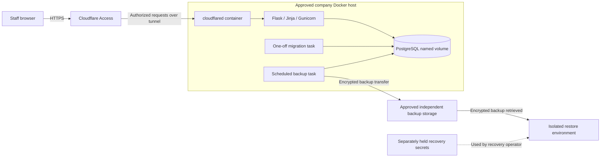

# Architecture review and proposed implementation plan

Reviewed: 2026-10-28. Status: proposal for review before further implementation.
Source baseline: `ca55539cf0dc8f173b5329289603a6b6ffeb78ca` on `develop`.

## Recommendation

Keep the existing Flask/Jinja application as a modular monolith. Use PostgreSQL
as the authoritative database, Docker Compose for the application and its
supporting services, and Cloudflare Tunnel plus Access for browser access.
Add explicit migrations, auditable business operations, and independently
recoverable backups before a pilot with real records.

This is a suitable small-system design; the prototype does not yet implement
its security, integrity or recovery guarantees. The hosting machine, identity
model, leave rules, recovery targets and backup destination still need decisions.
An open-source application and free Cloudflare access services do not provide
a free Docker host or eliminate operating and backup costs.

For preliminary tests, a dedicated VMware Linux VM on Windows has now been
selected. The Mac remains the development and eventual SSH management machine.
See [VM test environment](VM_TEST_ENVIRONMENT.md) and the root
[handoff](../HANDOFF.md). This resolves the test-host direction; the final
production machine remains undecided. Subsequent access/hardening/reboot checks
are recorded in HANDOFF.md; they do not establish application readiness.

## Requirements and evidence boundary

Confirmed requirements are internal attendance, work logs, leave/absence
requests, team calendar, account administration, browser/mobile use, Docker
deployment, security and data recoverability. CRM, subscriptions and accounting
are outside the first release. No existing prototype is in use with real records.

The reported initial team is about 10–20 employees and three administrators:
approximately 13–23 accounts, rather than a public multi-tenant product.
The exact count, budget and operational ownership remain to confirm.
No company identity provider or production host has been established. The
request for free plans and open-source components is a preference; a zero-cost
hosting arrangement has not been demonstrated. Whether attendance becomes
payroll input or official timekeeping is also unresolved.

This review inspects the committed prototype and its deployment scripts. The
committed suite previously passed 26 tests. It does not establish browser,
production, PostgreSQL, access-provider or recovery acceptance.

Before the request to review architecture first, preliminary migrations and CI
were prepared locally. They remain uncommitted drafts and are not the approved
baseline. A draft SQLite run passed 31 tests with migration-template deprecation
warnings. A disposable PostgreSQL container was started and removed, but the
PostgreSQL suite was not run. No deployment or restore test was performed.

The draft removes automatic initialization without yet updating all README and
installer paths, and its CI action pins still need review against current
releases. Those changes must be reconciled as a complete slice before use;
passing draft unit tests does not make the modified checkout release-ready.

## Stack choices

| Component | Assessment | Proposed decision |
| --- | --- | --- |
| Python / Flask | Already implements the selected workflows; request handlers, templates and extensions are easy to inspect. Business rules currently live inside handlers. | Retain Flask and the Dockerfile's Python 3.13 target; validate supported versions and dependencies before release. |
| Jinja / CSS / FullCalendar | Fits forms, approvals, tables and a calendar without a separate frontend service. Browser/mobile behaviour has not been reviewed. | Retain server-rendered pages and small JavaScript enhancements. Vendor the calendar assets or review their integrity/CSP loading; verify applicable licenses. |
| SQLAlchemy | Existing model/query layer is sufficient. It does not itself define correct time, leave or access rules. | Retain it; put transactional business operations and permission-aware queries in focused service functions. |
| Migrations | The committed factory uses `db.create_all()` during startup. There is no versioned upgrade path. | Review Flask-Migrate/Alembic as the migration mechanism. Run changes once in an explicit initialization/update step, before starting workers. |
| PostgreSQL | Already proposed in Compose. Supports independent connections, transactions and useful integrity constraints. | Use one supported major consistently in Docker development, integration tests and deployment; PostgreSQL 17 is already the prototype choice. Review security patch updates separately from major upgrades. |
| SQLite | Can serve small web applications and is not ruled out by headcount. It has different write/concurrency behaviour and a file-based operational model. | Keep only as an optional fast test/local mode. PostgreSQL tests remain authoritative for production behaviour. |
| Gunicorn | Already the Docker WSGI server. A fixed three-worker command is a draft capacity choice. | Retain it for the Linux container; size workers against the actual host and measured workloads. |
| Docker Compose | Fits a single host and a handful of services. | Make this the supported operational path. Local Python remains optional developer tooling. |
| Cloudflare | Can provide DNS, HTTPS ingress, an outbound tunnel and staff access control. | Use Tunnel/Access if the company accepts the dependency; do not treat either as application authorization or backup. |
| Backup tooling | A manual `pg_dump` command is documented; there is no automated recovery workflow. | Consistent PostgreSQL dumps, encrypted storage using an open-source tool such as restic, and a verified restore procedure. |

[Flask's design](https://flask.palletsprojects.com/en/stable/design/) intentionally
uses extensions for concerns outside its core. For this workload, the existing
implementation and the small number of workflows justify retaining that approach.
This is an engineering judgment, not a claim that Flask is inherently safer.

### Alternatives considered

| Alternative | Benefit | Cost or missing evidence | Judgment |
| --- | --- | --- | --- |
| Django | Integrated authentication, permissions, migrations and an admin interface. | Attendance, approval rules, employee-specific access and calendar workflows still need custom implementation and validation. | A reasonable greenfield alternative; no identified requirement currently justifies replacing the working Flask flows. Reconsider if the future maintainer requires it or most requirements become standard admin CRUD. |
| Older Next.js prototype | Broader existing modules and a TypeScript stack. | Different scope, separate implementation, client/server/auth tooling to maintain, and review findings of its own. | Retain as reference; no current requirement establishes the benefit of a rewrite or combining both apps. |
| Cloudflare Workers / D1 | Potentially very low hosted usage cost without managing a VM. | Different runtime, persistence and release model; current dependencies and data access are unproven there. | Investigate only if serverless hosting becomes the overriding requirement. It does not satisfy the preferred ordinary Docker deployment model. |
| All services in one image | One image name. | Couples database, web process and recovery lifecycle. | One Compose project provides a simple operating interface while services retain explicit storage and update boundaries. |

Django's own [admin documentation](https://docs.djangoproject.com/en/6.1/ref/contrib/admin/)
recommends its admin for internal model management and distinguishes that from
custom process-oriented interfaces. That distinction matters for clocking and
leave approvals here.

## Cloudflare and the free-plan constraint

The currently documented [Cloudflare One free plan](https://www.cloudflare.com/plans/)
allows 50 users, which is sufficient for the reported initial team. Actual
account usage and eligibility have not been inspected. Its short access-log
retention must not substitute for application audit history.

[Tunnel requires a server or VM running `cloudflared`](https://developers.cloudflare.com/tunnel/get-started/).
It connects the application to Cloudflare; it does not run the Docker application.
[Cloudflare Containers](https://developers.cloudflare.com/containers/platform/pricing/)
has no free compute allocation in the published pricing and uses Workers Paid
billing. The presence of a domain on a free zone plan does not provide that runtime.

Workers now support
[Flask via a WSGI adapter](https://developers.cloudflare.com/workers/languages/python/packages/flask/),
so Flask alone does not rule out that platform. However, Workers use a different
runtime with an [ephemeral filesystem](https://developers.cloudflare.com/workers/languages/python/stdlib/)
and [free CPU limits](https://developers.cloudflare.com/workers/platform/limits/).
They do not run the proposed Docker stack unchanged. A serverless adaptation
would require separate persistence/dependency/performance validation and is not
the recommended path while Docker portability is the goal.

The practical paths are:

1. An approved existing always-on company host: open-source containers plus
   free Tunnel/Access can avoid a new hosting subscription. Power, maintenance,
   backup media and operator time still exist.
2. A company-funded small Linux host: the same Compose architecture; hosting
   has a recurring cost to agree. No provider or price is selected here.
3. Strictly no host and no paid compute: reconsider serverless architecture
   explicitly rather than assuming the present Docker stack can run free on
   Cloudflare. This would change the implementation plan.

Do not silently choose a personal server for company HR data. Host ownership,
administration, storage location, access and continuity need an agreed owner.

## Proposed deployment and trust boundaries

The tunnel is initiated outbound by `cloudflared`; the diagram's arrows show
request flow after it is established.

The Compose application project and its host management services should provide:

- `web`: unprivileged application process, immutable application image,
  bounded resources, health/readiness checks and no persistent business data
  in the image or writable container layer.
- `db`: PostgreSQL with an explicit named volume, health check and a dedicated
  application identity. No host-published database port. The application role
  must not be the PostgreSQL superuser; migration privileges are separate from
  normal request handling where practical.
- `cloudflared`: the sole application ingress in the proposed tunnel topology;
  its credentials are scoped and kept outside source control. In the preliminary
  VM it runs as a host service alongside OpenSSH, preserving management access
  across application Compose changes.
- An explicit initialization/migration task using the application image, and
  a scheduled backup task with only the storage/network access it needs.

Keep the database on a private service network. Do not publish the web port on
the host's public/LAN interfaces as a second route around Access. A deliberate
loopback-only developer override can support local testing.

The current Caddy/80/443 Compose path is an alternative direct-ingress proposal.
Select one production topology rather than combining every prototype deployment
option. With a tunnel terminating public HTTPS, Caddy is not currently required
by the application. Configure trusted proxy handling explicitly and test secure
cookies, generated URLs and CSRF through the actual ingress.

Pin application releases and dependency/image versions with a reviewed update
process. Provide one documented install/update/backup/restore interface, but
keep migrations, worker startup and backups observable as separate operations.
Use health checks plus bounded restart behaviour; a restarting process is not
evidence of a working database or correct schema.

## Identity, authorization and confidentiality

The unknown company identity system is an architecture decision, not a reason
to add an identity server immediately. Two viable initial models are:

| Model | Benefit | Trade-off |
| --- | --- | --- |
| Access handles staff identity; application maps verified identity to existing users and roles | Staff avoid another password store; later company IdP integration can remain at the edge. | Requires correct JWT validation, explicit provisioning and a recovery procedure; ties normal sign-in to Access availability. |
| Access gates entry; existing application passwords handle login | Reuses the current login implementation. | Two sign-in steps and responsibility for password resets, session revocation, shared throttling and credential maintenance. |

Prefer the first model if company-controlled email and Access administration
are suitable. Access supports
[email one-time PIN without an established IdP](https://developers.cloudflare.com/cloudflare-one/integrations/identity-providers/one-time-pin/).
Email OTP alone is not a claim of multi-factor protection. Decide the required
administrator authentication strength and available recovery mechanism before
choosing this path. Keep the second model as a deliberate fallback decision,
not an undocumented permanent combination of logins.

For Access identity, validate the token signature, trusted issuer, application
audience and lifetime; handle signing-key rotation. Never trust an email header
alone. Cloudflare documents
[origin-side JWT validation](https://developers.cloudflare.com/cloudflare-one/access-controls/applications/http-apps/authorization-cookie/validating-json/).
Only pre-provisioned active users may enter the application. A verified domain
or email must never automatically grant administrator status.

Regardless of login model:

- Enforce an employee/admin permission matrix in every read, write and export.
  Employee access means their own time/work/leave details plus limited team
  availability. Administrative capabilities are explicit; decide whether all
  administrators should see medical absence details or approve their own leave.
- Preserve CSRF protection, secure/HTTP-only cookies, bounded session lifetime,
  and immediate application-level deactivation checks. Credential changes or
  account recovery must have a defined session-revocation outcome.
- Provide an audited console-only recovery mechanism and separately secure
  recovery of the Cloudflare/company account. Do not introduce a public bypass.
- Use generic availability in colleague-facing calendars; keep reasons and
  medical categories restricted. Avoid collecting medical attachments or other
  extra information without an identified requirement.
- Mark private pages, calendar feeds and exports `Cache-Control: no-store` and
  verify Cloudflare cache rules preserve that behaviour. This follows
  [Cloudflare's cache-control semantics](https://developers.cloudflare.com/cache/concepts/cache-control/).
- Scope project suggestions and reports to the viewer; protect exported text
  against spreadsheet formula interpretation. Keep staff details and tokens
  out of operational logs.
- Set request/field/date-range bounds and security headers. Review external
  JavaScript before adopting a content security policy.

Secrets should be supplied through restricted files or a reviewed secret
mechanism. [Compose secrets](https://docs.docker.com/compose/how-tos/use-secrets/)
mount files per service; this is not a guarantee of encrypted storage on the host.
Protect the source files, host disk, SSH/admin access and backup credentials.
Agree protection of data at rest on the host; containers do not encrypt their
volumes automatically. Keep public access and backup transfers encrypted. If
database traffic crosses hosts, require authenticated TLS rather than extending
the single-host private-network assumption.
The source repository's visibility does not provide application access control.

## Domain model and integrity

Use small business-service modules for attendance, leave, reporting and
authorization. HTTP handlers validate input and present results; a transaction
should perform each business change and its audit record together. Avoid a
generic repository abstraction or unrelated module rewrite.

| Domain | Current evidence | Proposed rule |
| --- | --- | --- |
| Identity | `User` combines account state, role and a single vacation allowance. | Keep one user identity and two roles unless business permissions require more; link external identity explicitly if chosen. |
| Attendance | Naive local timestamps and check-before-insert clocking. | Store UTC instants, display in Europe/Lisbon, and enforce one open record per person in the database. Serialize competing changes and reject overlapping records. |
| Totals | Queries choose sessions by start date; DST and cross-period work are mishandled. | Query intervals intersecting the reporting period, clip at local day/month boundaries converted to UTC, and sum elapsed durations. |
| Corrections | Only last editor retained; deletion removes the row. | Require a reason; retain original/revised values, actor and UTC timestamp. Prefer a void/correction operation retaining history over hard deletion. |
| Work logs | Floating-point hours and free-text project names. | Define precision, preferably integer minutes; keep work logs distinct from clocked presence. Scope suggestions and exports. |
| Leave allowance | One number applies to all years; working days use a global Monday–Friday calendar. | Record entitlement by employee/year, and confirm working schedules, carryover, half-days and part-time rules before choosing units or calculations. |
| Leave transitions | Application checks can race; review/cancellation overwrite current state. | Define transitions, protect the entitlement/overlap transaction, and record decisions/cancellations in history. |
| Calendar | Approved leave kind shown to everyone. | Separate team availability from restricted leave details in the server response, not only the template. |

A PostgreSQL partial unique index can protect the open-session rule. Overlap
checks need a transaction/locking strategy across every clock/admin entry path;
range exclusion constraints are another available option to evaluate against
deployment permissions and complexity. PostgreSQL documents
[range exclusion constraints](https://www.postgresql.org/docs/17/rangetypes.html#RANGETYPES-CONSTRAINT).
Duplicate submissions should return a stable result rather than create duplicates.

For a small first release, do not invent a full payroll or statutory leave
engine. A narrow, explicitly agreed entitlement/work-calendar policy is preferable.
The prototype's 22-day default is not evidence of correct entitlement for each
employee. Do not force task hours to equal presence without a business requirement.

Application audit history supports accountability; it is not tamper-proof
against a database administrator and is not a backup. Restrict ordinary audit
mutation and define retention/access to sensitive historical fields.

## Recovery design and acceptance

[Docker volumes](https://docs.docker.com/engine/storage/volumes/) separate data
from container replacement. They do not protect against host loss, destructive
volume removal, corruption, credential compromise or accidental application edits.

Proposed targets to agree, not current guarantees:

| Item | Proposed starting target |
| --- | --- |
| Recovery point: acceptable data loss | At most four hours; also take a recovery point before schema-changing releases. |
| Recovery time: return to service | Four hours after an incident, subject to agreed operator coverage and measured restore time. |
| Backup schedule | Every four hours, with failure detection and notification to the chosen owner. |
| Retention | Keep recent four-hour points for 48 hours, then 14 daily, 8 weekly and 3 monthly points, subject to storage and business privacy rules. |
| Validation | Check backups routinely; restore to a clean isolated environment before pilot use and after material recovery changes. |

These are technical defaults for discussion. Business-record retention and
backup retention are separate decisions, and no 24/7 support commitment is implied.

Back up a consistent application database dump, its schema revision, the matching
application/image release, required deployment configuration and the means to
recreate dedicated database roles. Exclude unrelated databases and unnecessary
host inventories. Plan for future uploaded files only if that feature is added.
[PostgreSQL documents](https://www.postgresql.org/docs/17/backup-dump.html)
consistent logical dumps; copying a live data directory or relying on a plain
file copy is not the selected strategy.

Encrypt the backup before off-host transfer. An open-source tool such as restic
provides encrypted repositories; its
[repository integrity checks](https://restic.readthedocs.io/en/stable/045_working_with_repos.html)
need an appropriate data-verification mode as well as actual restore exercises.
Store recovery keys outside both Git and the only application host, with access
available to an agreed second custodian. Losing the decryption key defeats recovery.

Maintain an independent copy with credentials and deletion controls separate
from the web application. A single copy in the same Cloudflare account shares
an account-compromise risk; assess an additional protected/offline copy. The
backup destination must be approved for company data before uploading anything.

[R2 Standard](https://developers.cloudflare.com/r2/pricing/) currently includes
10 GB-month of storage and operation allowances for free. It is an optional
encrypted-backup destination, not a selected service or a guarantee of no charges.
Retention size and operations must be measured; exceeding allowances can cost
money. Company approval, account recovery and storage-location requirements
remain necessary even with client-side encryption.

The restore rehearsal must:

1. Start with an empty database volume and the documented recovery materials,
   rather than reuse the live database or an already-running application.
2. Retrieve/decrypt a backup, recreate only required roles, restore the database
   with the matching application version and verify migration state.
3. Verify representative records and counts, attendance totals, leave balances,
   correction history, and employee/admin access using synthetic fixtures.
4. Verify normal startup after restart, the backup schedule and a subsequent
   backup. Measure recovery-point age and total recovery duration.
5. Prove the operator can obtain the necessary secrets independently of a lost
   application host. Re-establish ingress only after isolated verification.

Backup failure, stale backup, failed restore, disk exhaustion and an unreachable
host need observable outcomes. Alerts and recipients will be chosen explicitly;
this review does not send messages or enable monitoring.

## Gaps in the committed prototype

| Priority | Finding and source | Required evidence before real use |
| --- | --- | --- |
| P1 | Timezone/DST and start-date-only reporting: `app/utils.py:now`, `WorkSession.duration`, attendance/dashboard queries | DST, overnight and month/year boundary cases with agreed totals |
| P1 | Open/overlapping sessions lack a database invariant: attendance clock/admin handlers and model | Competing requests leave one valid result; invalid admin edits rejected |
| P1 | Correction/deletion history incomplete: `WorkSession.edited_by_id`, attendance deletion | Auditable correction/void with actor, reason, before/after values |
| P1 | Medical absence kind exposed in calendar/dashboard | Role-specific server responses; employee, colleague and admin tests |
| P1 | Recovery is a volume plus a manual dump example: Compose and README | Encrypted independent backup and verified clean restore |
| P1 | Login/account lifecycle and production ingress not chosen: auth handlers, service/tunnel scripts and Compose | Agreed identity/recovery model; deny unknown/inactive users and invalid tokens; no direct public bypass |
| P1 | No committed migration path or CI: factory and repository tree | Clean database initialization, upgrade/data-preservation checks and actual PostgreSQL integration results |
| P2 | Annual/part-time entitlement and approval policy unresolved: User/LeaveRequest and leave handlers | Agreed rules and calculation/transition cases; escalate before pilot if these affect the first users |
| P2 | Project suggestions and CSV text not sufficiently scoped/protected: tasks and attendance handlers | Cross-user and spreadsheet-safe export checks |
| P2 | External calendar assets, security headers, dependency updates and mobile UX unverified | Browser and dependency review against the selected deployment |

Priorities describe implementation sequencing for the proposed pilot, not a
formal risk score or proof of exploitable production vulnerabilities.

## Implementation sequence after review

| Step | Deliverable | Completion gate |
| --- | --- | --- |
| 0 | Agree host/access approach, timekeeping purpose, leave/visibility rules, recovery targets and ownership | Recorded decisions; unresolved points have an owner and do not silently become code defaults |
| 1 | Reconcile draft migrations/CI; establish PostgreSQL Docker development and an explicit init/upgrade command | Clean install works; normal startup does not mutate schema/seed users; repeated upgrade preserves records; current models match schema |
| 2 | One trustworthy attendance workflow from identity to database, totals and correction history | Concurrent clocking, permissions, DST/boundary and audited-correction tests on PostgreSQL |
| 3 | Leave/work-log/calendar workflows with agreed privacy and safe exports | Role matrix, yearly/part-time cases and desktop/mobile workflows verified |
| 4 | Container deployment/recovery package | Reviewed Compose topology; no exposed database; backup failure detection; clean restore passes with measured recovery targets |
| 5 | Small internal pilot and maintainer documentation | Named acceptance owner, synthetic-to-real-data decision, update/rollback procedure and remaining issues reviewed |

Build a useful tested slice before adding ancillary features. Use PostgreSQL in
integration tests, a fresh migration install and upgrade checks, cross-user
authorization tests, and browser checks for both roles. Test a modest burst of
simultaneous clock submissions; this is more relevant than speculative scale.

The desired 1–2 week horizon is a planning target, not a verified estimate.
Forecast the remaining work after Step 0 and the first attendance slice, using
actual allocated hours and observed effort. Recovery and security gates belong
inside the first useful release, rather than an unspecified later hardening phase.

## Decisions to resolve next

1. Is there an approved always-on company Docker host? If not, is a small hosting
   cost acceptable, or does strict zero-cost hosting override Docker portability?
2. Should Access supply application identity, or remain an outer gate around
   local accounts? Who administers company email, Access and emergency recovery?
3. Is attendance internal tracking or official/payroll input? Which working
   schedules, leave units/entitlements and approval/privacy rules apply?
4. Are the proposed recovery-point/time targets acceptable, where may encrypted
   backups live, and who can recover the system if its usual operator is absent?

Update 2026-10-29: the user authorized the local Docker/PostgreSQL foundation
slice after staging SSH setup. Business rules, application identity, production
hosting and backup ownership remain decisions before their dependent work.
Consult HANDOFF.md and the README for the latest implementation/verification state.

Local attendance checkpoint, 2026-10-29: the user authorized Step 2. UTC instants,
local-day/month clipping, serialized clock transitions, database overlap protection,
versioned administrator corrections and retained void/audit history are implemented
and uncommitted. The PostgreSQL range constraint uses built-in GiST range operators
and does not require a privileged extension. Versioned legacy records receive an
explicit UTC conversion baseline; ambiguous/invalid records stop migration rather
than receive guessed values. Local suites passed 68 SQLite tests (four concurrency
cases skipped) and 72 PostgreSQL tests. See DEVELOPMENT.md and the README for
scope and migration limits. This addresses the attendance findings above locally;
browser/mobile acceptance, business policy, hosted CI, staging deployment and
independent recovery are still outstanding. Work-log CSV/suggestion and leave
privacy findings remain open.

Functional MVP checkpoint, 2026-10-29: the user authorized completion of the
original scope using configurable reasonable defaults, then later requirement
alignment. Remaining local workflow/security findings are addressed: private
leave availability, transactional leave balances/history, scoped work-log
suggestions/exports, revocable account sessions and database login throttling.
The local encrypted full-schema recovery rehearsal and Chromium/WebKit desktop/
mobile workflows pass. See REQUIREMENTS.md for current acceptance and OPERATIONS.md
for the prepared HTTPS pilot. Historical open rows above describe the reviewed
prototype; local completion does not establish company policy, live ingress,
independent off-host disaster recovery or hosted CI. Production placement and
operational owners remain decisions before real use.
