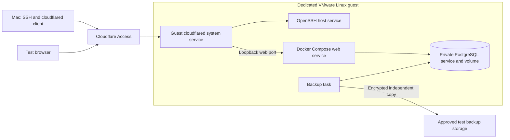

# VMware preliminary test environment

Updated: 2026-10-29. Status: Mac public-key SSH through Access and authentication
hardening and reboot recovery are verified; non-allowlisted identity testing remains open.

## Reported platform checkpoint

The Windows handoff reports Ubuntu Server 24.04.5 amd64 installed from media
verified against the official checksum. The guest has a 40-GiB thin disk,
2 vCPU, 4 GiB RAM, EFI and NAT; unrelated VMs were left unchanged.
OpenSSH 9.6p1, Docker Engine 29.9.2, Compose 5.6.1 and cloudflared 2026.10.5
are reported installed. SSH, Docker, guest tools and time synchronization
recovered after a verified guest reboot, and a disposable Docker test passed
before and after it. These results were not independently rerun from the Mac.

Windows reports the approved Mac public key enrolled for the named `bsmanager`
sudo account, with restrictive SSH-file permissions and privately established
console recovery credentials. The operator is not in the Docker group. Windows
SSH verified the console-obtained guest host fingerprint and connected.
The full guest host public key was supplied on 2026-10-29 and matched to that
fingerprint on the Mac before dedicated known-host enrollment. Live SSH has now
passed strict verification against this pin. Never transfer a private key.

The user enrolled a connector and created the exact SSH route after its separate
Access application/policy. The enabled active connector is the standard
`cloudflared.service`; the previously prepared dedicated service remains disabled.
The active connector uses a token file in a root-owned 0700 directory; exact file
metadata from the operator's sudo check confirms root ownership and mode 0600.
The operator applied the reviewed SSH authentication snippet after syntax and
effective-setting validation. A fresh Mac key session passed; the server now
offers only public-key authentication. Password, keyboard-interactive and root
SSH login are disabled, while console credentials and sudo are preserved.
A coordinated guest reboot changed the recorded boot ID. Fresh Mac key login,
SSH socket activation, connector recovery and persisted hardening passed; the
unused dedicated connector stayed disabled. Post-reboot unauthenticated requests
still redirect to Access, and an SSH connection without a key is rejected.

The guest root filesystem reportedly has about 11 GiB free, with additional
unallocated LVM capacity. Check capacity before image builds; do not resize
storage incidentally during access setup. No application, real records,
snapshot or tested backup exists.

Mac cloudflared 2026.10.4 and the approved public-key fingerprint were verified
locally on 2026-10-29. A dedicated strict SSH configuration and pinned host key
are saved outside Git, with restrictive permissions; effective configuration
parsing passed. Existing global SSH files were preserved.
Unauthenticated HTTPS/WebSocket requests redirect to Access with TLS verification
passing. The user completed browser authentication, then Mac public-key SSH and
a read-only guest audit succeeded. A session without guest authentication was
denied; a non-allowlisted Cloudflare identity remains untested. The guest audit
found only SSH listening beyond loopback, loopback-only connector metrics, correct
operator SSH-file modes and no application/database TCP listener.

The Mac's native resolver still returns an earlier negative DNS result despite
authoritative and configured DNS servers resolving the record. Successful SSH
used a per-process resolver override against the same configured DNS server;
that option is now in the dedicated SSH profile, with parsing verified. System
DNS/VPN settings were preserved; native system resolution remains unresolved.
An automatically rejected Windows disk-check command remains unverified; do not
retry it, substitute a repair operation or treat that check as passed.

User-supplied dashboard screenshots show One-time PIN configured, the initial
single-email Allow policy associated with the SSH application, and route creation.
The user selected a seven-day application duration inherited by the policy and
retained all available identity providers. These are screenshot/report evidence;
no Cloudflare account API audit was performed.
Dashboard operation remains manual; no browser automation or management OAuth.
The earlier inconclusive Windows reachability check is superseded by successful
Mac SSH and the later explicit reboot/recovery checks. These do not establish
application persistence or backup restoration.

## Access setup and verification procedure

1. Verify the owner of the tunnel in the approved Cloudflare account. Use the
   prepared dedicated SSH hostname and operator-supplied initial email allowlist.
   Future identities may be added or replaced through deliberate policy updates;
   adding a Cloudflare identity alone does not enroll an Ubuntu SSH key.
   Inspect existing resources before
   creating anything. Do not reuse or change an unrelated tunnel or policy.
2. Create the separate SSH Access application and allow policy before publishing
   its route. Include only the approved operators; inspect policy overlap and
   bypass rules. Publish only SSH to the guest's loopback SSH listener.
3. Enroll the dedicated connector using its protected token file and validate
   service health without displaying credentials or raw service configuration.
4. Use the Mac's verified and pinned ED25519 host key with strict checking,
   then test Access and SSH separately.
   Record allowed login and denied identity results; an Access login page alone
   does not establish either SSH login or denial enforcement.
5. After Mac login works, validate effective SSH settings before reloading;
   retain console recovery and test a second key-only session. Reboot only with
   operator coordination and verify connector and SSH recovery afterward.

The Mac has no available Cloudflare account integration in this task. Dashboard
configuration and Windows execution require the approved operator workflow;
prepared instructions do not establish that routes, policies or a connector exist.

## Purpose and boundary

Use a new dedicated Linux VM on a Windows VMware host for preliminary deployment
testing. Keep local application development and fast tests on the Mac, then
validate reviewed changes in the VM using the proposed production operating
pattern. The final company production host is not selected.

This environment uses synthetic records. Successful VM testing does not establish
production availability, approved company-data hosting or production readiness.
Do not reuse another lab VM, its disks, identities or credentials.

## Proposed VM profile

| Item | Starting configuration |
| --- | --- |
| Guest | Ubuntu Server 24.04 LTS; verify installation media against official checksums |
| Architecture | Match the Windows host and VMware support; verify before selecting media |
| Resources | 2 vCPU, 4 GiB RAM, 40 GiB thin-provisioned disk, subject to measured host capacity |
| Network | VMware NAT with outbound connectivity; no router forwarding or unsolicited Windows firewall changes |
| Time | Working time synchronization; UTC system clock; application display in Europe/Lisbon |
| Platform | Docker Engine, Compose plugin, OpenSSH server, open-vm-tools and cloudflared |
| Access | A named non-root operator; verified SSH public-key authentication; scoped administrative access |
| Data | Dedicated application volumes; no patient or real employee data |

These are initial allocations, not measured capacity guarantees. Inspect the
host first and leave other VMs and workloads unchanged. Stop for a capacity or
privilege conflict rather than resize existing workloads. Docker Engine runs
inside the Linux guest; this plan does not require nested VMware virtualization
or another Docker Desktop installation inside the guest.

## Management and application paths

The connector initiates outbound tunnel connections. Keep OpenSSH and the
management connector available independently of application Compose restarts.
The application, database, migration task and backup tooling remain container
deployable. The test VM's SSH/tunnel are host management services, not part of
the application image.

Propose separate Access applications for administrator SSH and application
testing, with separately scoped allow lists. The SSH rule must not grant access
to every staff account. Confirm the exact Cloudflare zone and dedicated test
hostnames before creating routes. Do not repoint the intended production
management hostname or alter existing services.

[Cloudflare documents client-side cloudflared SSH](https://developers.cloudflare.com/cloudflare-one/networks/connectors/cloudflare-tunnel/use-cases/ssh/ssh-cloudflared-authentication/)
with cloudflared on both ends and an SSH ProxyCommand on the client. A web
application tunnel alone does not establish native SSH access. Verify the guest's
SSH host-key fingerprint through its console before accepting it on the Mac.
Do not disable host-key checking.

The connector should use a protected token file rather than expose credentials
in a prompt, process argument, report or Git. Cloudflare supports
[`--token-file`](https://developers.cloudflare.com/cloudflare-one/networks/connectors/cloudflare-tunnel/configure-tunnels/run-parameters/).
Do not print service files or debug logs which might expose credentials.

Application web ports should be bound to guest loopback when the connector runs
on the host. PostgreSQL has no host-published port. Verify actual bindings rather
than assuming a firewall blocks Docker-published ports; Docker documents
[firewall interactions](https://docs.docker.com/engine/install/ubuntu/#firewall-limitations).

## Work split and checkpoints

1. **Windows agent: discovery and VM creation.** Inspect VMware availability,
   host architecture and free resources. Create only the dedicated VM, install
   the guest and record the media, resource choices and actual guest identity.
   If a hypervisor operation requires interactive user input, report that precise
   step rather than alter unrelated virtualization settings.
2. **Windows agent: platform bootstrap.** Install Docker/Compose, OpenSSH and
   cloudflared from official sources. Validate Docker with disposable test data.
   Prepare SSH using the Mac operator's supplied public key; never transfer its
   private key. Keep console recovery available throughout access changes.
3. **Operator/Windows agent: scoped connector setup.** Resolve the exact zone,
   SSH test hostname and administrator Access policy before changing Cloudflare.
   Use credentials locally through the approved mechanism. If account access or
   the exact route is missing, finish unaffected VM work and report that gate.
   Do not publish a temporary unauthenticated service as a shortcut.
4. **Mac agent: access verification.** Install a client connector if needed,
   verify the console-supplied SSH fingerprint, and test key-based login through
   Access. Check SSH configuration before reloading it. Disable password/root
   login only after the intended key path works and console recovery is retained.
5. **Mac agent: application deployment after architecture/development review.**
   Transfer an explicitly identified source/image version, apply initialization
   once, then start the containerized application and verify allow/deny access.
   Do not deploy the currently unfinished migration/CI drafts as a completed build.
6. **Both environments: recovery and repeatability.** Test container replacement,
   guest reboot, persistence, application access and restoration into an empty
   database using a separate backup copy. Record exact results and remaining gaps.

The initial handoff stops at VM/platform preparation and an access-readiness
report. Application deployment and publication wait for an identified, reviewed
artifact and complete application setup instructions.

## Local iteration and source transfer

- Use local Python or Docker for fast Mac checks without a public tunnel.
  PostgreSQL integration tests must exercise the intended deployment database.
- The current Mac is arm64; verify the guest architecture. Build on the guest
  or produce an explicitly matching/multi-platform image before runtime checks.
- Deploy a recorded clean commit/image, or use an explicitly approved,
  allowlisted development bundle with file hashes when testing uncommitted work.
  Do not assume local files appear on another machine through a branch name.
- Keep credentials, `.env`, private keys, database files, caches, local virtual
  environments and unrelated project data out of source transfers. Do not use
  destructive synchronization over persistent data or secrets.
- Record the deployed revision/image and migration version on every test update.
  Keep developer reload/debug servers local; exercise the normal container server
  in the VM.

## Recovery and availability limits

The Windows host, VMware process, guest, networking and storage are dependencies.
Suspending Windows or the guest can interrupt both SSH and the application.
Record expected power/suspend behaviour without changing global Windows power,
BitLocker, firewall or security settings as an incidental setup step.

A VMware snapshot is a useful temporary bootstrap checkpoint; it is not the
application backup. Copies kept only inside the guest or on its Windows host
share that host's failure domain. Test encrypted backup/restore using a separate
approved destination and separately recoverable credentials. The architecture
review's recovery targets remain proposals until measured and accepted.

## Acceptance evidence

| Checkpoint | Evidence required |
| --- | --- |
| VM ready | Selected OS/media, architecture, resources, usable capacity, time sync and guest reboot result |
| Runtime ready | Docker/Compose versions, disposable test success, automatic startup after guest reboot |
| Access ready | Console-confirmed SSH host fingerprint, accepted Mac key, Access route/policy, successful Mac SSH and an unauthorised-access denial |
| Management independent | SSH remains usable during application container restart/replacement |
| Application test | Exact artifact/migration version, employee/admin workflows, private port bindings and intended browser access |
| Data recovery | Synthetic record reconciliation after restore into empty storage, backup age, elapsed recovery time and missing dependencies |

Return only a sanitized readiness summary to the source project. Private host
addresses, account identifiers, paths and access material belong in approved
private operational storage; credentials and raw diagnostics do not belong in chat.
